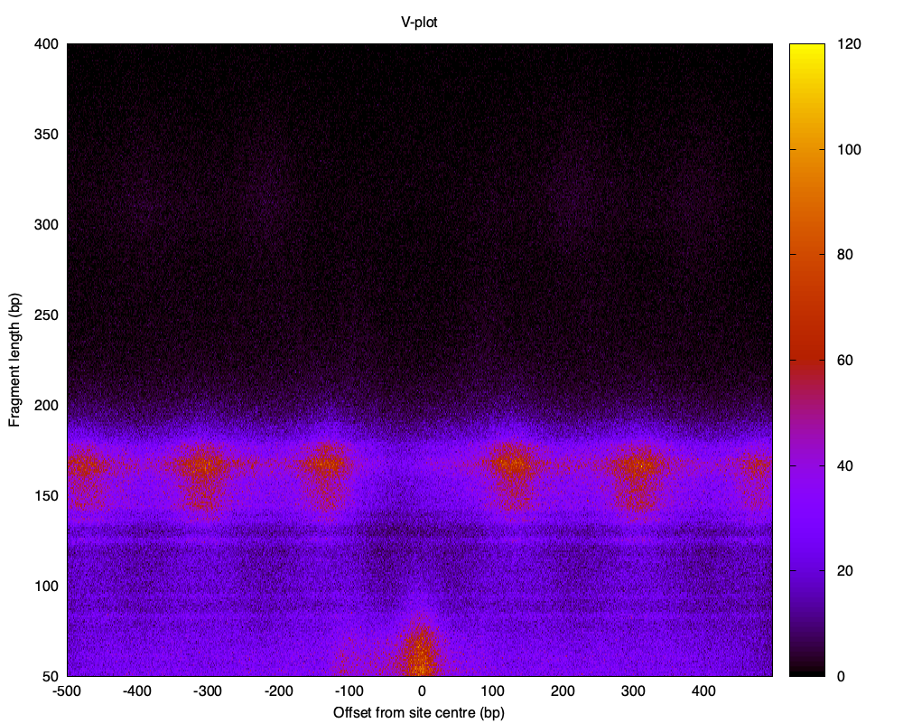

# Project 3: V-plot

This project makes a V-plot of cfDNA fragments around reference sites.

- x-axis: offset of the fragment midpoint from the site centre (-500 to 499)
- y-axis: fragment length (50 to 400)
- colour: number of fragments

## Files

- `vplot.py`: reads the mapped data from standard input and prints the matrix
- `plot_vplot.gp`: Gnuplot script that draws the matrix as `vplot.png`

## Input

Tab-separated file (columns counted from 1):

- column 5: site, e.g. `chr1:91382-91550|carroll_ctcf`
- column 8: fragment chromosome
- column 9: fragment start
- column 10: fragment end

## How the code works

For every line:

1. site centre = (site start + site end) // 2
2. fragment midpoint = (fragment start + fragment end) // 2
3. offset = fragment midpoint - site centre
4. length = fragment end - fragment start
5. If the fragment is on the same chromosome as the site, and the offset and length are in range, add 1 to the matrix

## Output (wide form)

351 rows, one for each length from 50 to 400.
Column 1 is the length; columns 2 to 1001 are the counts at offsets -500, -499, ..., 499.

## How to run

```bash
zcat < data.bed.gz | python3 vplot.py > vplot_wide.txt
gnuplot plot_vplot.gp
```

This creates `vplot.png`.


